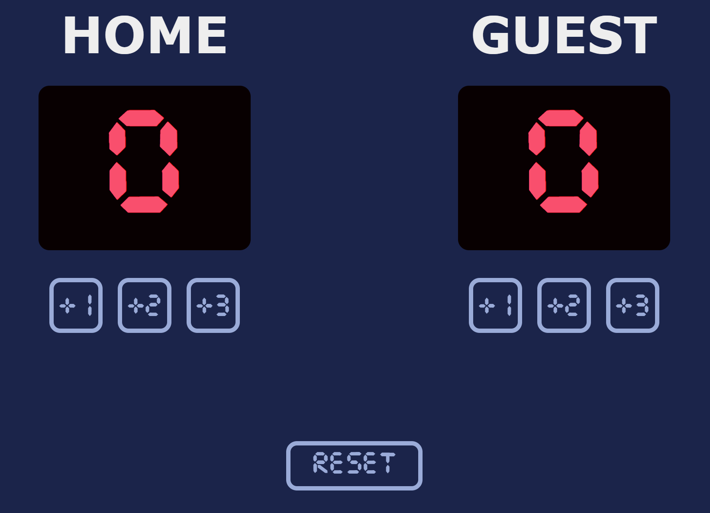

# Scoreboard App

A digital scoreboard interface built with HTML, CSS, and JavaScript. Features a clean, retro pixel-art design with separate HOME and GUEST score tracking, increment buttons (+1, +2, +3), and a reset functionality.

## Live Demo

**[View Live Demo](https://ryo-scoreboard.netlify.app/)**

## Screenshot

The app displays a digital scoreboard interface with a clean, pixel-art style against a dark blue background. It features separate HOME and GUEST sections, each with score displays and increment buttons (+1, +2, +3), plus a reset button at the bottom.

## Features

- **Dual Score Tracking**: Separate score displays for HOME and GUEST teams
- **Flexible Scoring**: Three increment options (+1, +2, +3) for each team
- **Reset Functionality**: One-click reset to start over
- **Retro Design**: Pixel-art aesthetic with segmented digital number displays

## Credit

Built while following the [Scrimba](https://scrimba.com/) Frontend Developer Path.
